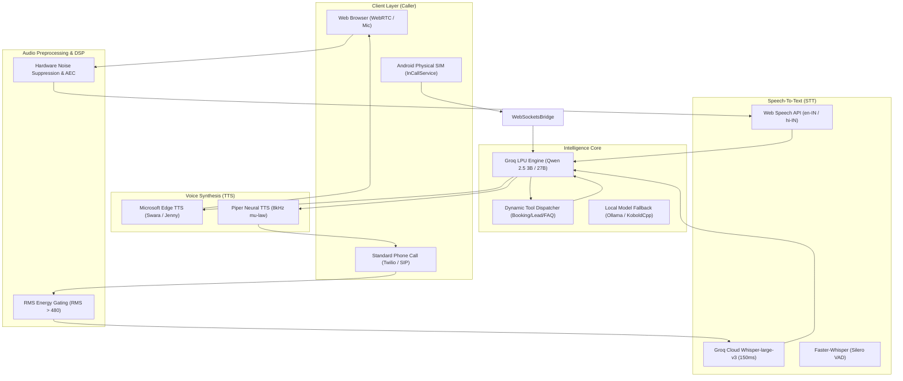

# 🎙️ SalesAgent AI — Real-Time Autonomous Duplex Voice Sales Architecture

> **An ultra-low latency, full-duplex conversational voice AI system engineered for sales closing, objection handling, appointment booking, and customer support. Operates over WebRTC WebSockets, Twilio telephony, and physical Android SIM cards.**

---

## 📑 Table of Contents
1. [Executive Overview](#-executive-overview)
2. [Current Project Status (क्या-क्या बन चुका है vs क्या बाकी है)](#-current-project-status)
   - [✅ 100% Completed & Verified](#-1-what-is-100-completed--ready-kya-ban-chuka-hai)
   - [🚧 Roadmap & Next Steps](#-2-what-is-in-progress--roadmap-kya-baki-hai)
3. [Architecture Overview](#-architecture-overview)
4. [Subsystem Breakdown](#-subsystem-breakdown)
   - [1. Realtime Web Voice Agent (`realtime-voice-agent/`)](#1-realtime-web-voice-agent-realtime-voice-agent)
   - [2. Telephony Voice Agent (`voice-agents/`)](#2-telephony-voice-agent-voice-agents)
   - [3. Android Physical SIM Bridge (`android-bridge-source/`)](#3-android-physical-sim-bridge-android-bridge-source)
5. [Sales Intelligence & Datasets (30,000 Samples)](#-sales-intelligence--datasets-30000-samples)
6. [Quick Start & Installation](#-quick-start--installation)
   - [Web Voice Agent Setup](#a-real-time-web-agent)
   - [Telephony Python Agent Setup](#b-telephony-agent)
7. [Model Fine-Tuning Guide (Google Colab + Unsloth)](#-model-fine-tuning-guide-colab--unsloth)
8. [Repository Directory Structure](#-repository-directory-structure)
9. [License & Credits](#-license--credits)

---

## 🌟 Executive Overview

**SalesAgent AI** is designed to solve the critical hurdles of commercial voice bots:
- **Zero-Delay Response (<500ms):** Employs Groq LPU inference (`qwen/qwen3.8-27b`) and sentence-boundary streaming TTS to mimic natural human speech cadences.
- **Hardware-Level DSP Audio Filtering:** Eliminates background fan noise, room echo, keyboard clicks, and distant voices using WebRTC hardware echo cancellation and noise suppression.
- **Instant Full-Duplex Barge-In:** When the user interrupts mid-sentence, the agent instantly ceases audio playback, aborts pending token generation, and listens without overlap.
- **Physical SIM & Telephony Support:** Supports standard WebRTC in the browser, Twilio Media Streams, and direct Android InCallService physical SIM cards to bypass expensive per-minute VoIP carrier bills.
- **30,000 Expert Sales Training Samples:** Pre-formatted datasets rooted in the psychological methodologies of Jordan Belfort, Chris Voss, Alex Hormozi, Brian Tracy, and Indian sales leaders.

---

## 📊 Current Project Status

### ✅ 1. What is 100% Completed & Ready (क्या बन चुका है)

| Component | Status | Details |
| :--- | :---: | :--- |
| **Realtime Web Voice Agent** | `100% Done` | Full-duplex WebSocket architecture with browser Web Speech STT, streaming LLM, and Edge-TTS. |
| **Acoustic Noise Filtering (STT)** | `100% Done` | WebRTC hardware constraints (`echoCancellation`, `noiseSuppression`, `autoGainControl`) + confidence gating (<0.35 rejected). |
| **Instant Barge-In (Interruption)** | `100% Done` | `currentSource.stop(0)` hardware cut-off on user speech + backend `AbortController` cancellation. |
| **Edge-TTS Neural Voice Engine** | `100% Done` | Microsoft Edge TTS integration with automatic script detection (Hindi `hi-IN-SwaraNeural` & English `en-US-JennyNeural`). Fixed `voiceLocale` bug. |
| **Zero-Latency LLM Streaming** | `100% Done` | Punctuation boundary chunking (`[.!?।\n]`) with primary model `qwen/qwen3.8-27b` (zero reasoning delay) and `openai/gpt-oss-120b` fallback. |
| **Telephony Phone Agent** | `100% Done` | FastAPI server (`server.py`) with Twilio Media Streams, 8kHz $\mu$-law transcoding, and resilient WebSocket loop. |
| **Ambient Noise Gate (Backend)** | `100% Done` | RMS energy thresholding (`SPEECH_RMS = 480`) + Groq Cloud Whisper (`whisper-large-v3`) + hallucination blacklist. |
| **3 Specialized Phone Agents** | `100% Done` | 1. Booking Agent (`check_slots`, `book_appointment`)<br>2. Customer Support Agent (`search_faq`, `save_callback`)<br>3. Lead Qualification Agent (`save_lead`). |
| **Validation & Smoke Tests** | `100% Done` | `smoke_test.py` validates all booking, lead, callback, and FAQ tools (17/17 tests passing, 0% errors). |
| **30,000 Sales Training Dataset** | `100% Done` | `sales_training_30000.jsonl` unified in dual Alpaca + ChatML format ready for SFT / LoRA fine-tuning. |
| **4 Master Research Playbooks** | `100% Done` | Full markdown playbooks for Western Titans, Indian High-Energy Legends, Modern Aggressors, and Mindset Persuasion. |
| **Android Physical SIM Bridge** | `100% Done` | Complete Kotlin source code for `VoiceAgentCallService` (InCallService), `WebSocketManager`, and `MainActivity`. |

---

### 🚧 2. What is In Progress / Roadmap (क्या बाकी है)

| Feature | Target State | Suggested Approach |
| :--- | :--- | :--- |
| **Custom Voice Training (Cloning)** | Train your own voice clone into a lightweight `.onnx` model. | Record 30–60 mins of clean audio, train on Google Colab using Piper TTS notebook, and export to `voices/my_voice.onnx`. |
| **Local Offline LLM Hosting** | Run 100% offline without Groq API dependency. | Follow our Google Colab Unsloth script to train `sales_training_30000.jsonl`, export to GGUF, and load into Ollama (`http://localhost:11434/v1`). |
| **Android APK Compilation** | Build release `.apk` for the physical phone bridge. | Open `android-bridge-source` in Android Studio, configure server IP in `WebSocketManager.kt`, and compile APK. |
| **Production Database Integration** | Upgrade local `leads.csv` & `bookings.json` to cloud SQL. | Connect `tools_impl.py` to PostgreSQL / Supabase / HubSpot API. |

---

## 🏗 Architecture Overview



---

## 📦 Subsystem Breakdown

### 1. Realtime Web Voice Agent (`realtime-voice-agent/`)
- **Frontend (`public/`):**
  - Card UI with clean responsive design and real-time conversation transcript.
  - Active DSP microphone stream (`echoCancellation: true`, `noiseSuppression: true`, `autoGainControl: true`).
  - True barge-in: Stops active speaker buffer immediately via `AudioBufferSourceNode.stop(0)`.
- **Backend (`src/`):**
  - Node.js Express server with native WebSockets.
  - `llm.service.js`: Streams completion chunks on punctuation pauses (`[.!?।\n]`) with `AbortController` cancellation.
  - `tts.service.js`: Cleans markdown and robotic symbols, synthesizes natural audio using Microsoft Edge TTS, auto-selecting Hindi or English voices.

### 2. Telephony Voice Agent (`voice-agents/`)
- **FastAPI Core (`server.py`):**
  - Handles Twilio voice webhooks: `/voice/menu`, `/voice/booking`, `/voice/support`, `/voice/lead`.
  - Real-time bidirectional WebSocket stream (`/media/{agent_name}`) transcoding 8kHz $\mu$-law.
- **Brain Engine (`brain.py`):**
  - `CallBrain`: Maintains turn-taking state, conversational history, and barge-in detection.
  - Multi-tier STT: Groq Cloud `whisper-large-v3` + local Faster-Whisper with Silero VAD fallback.
  - Hallucination rejection blacklist against repetitive Whisper artifacts.
- **Agents & Tools (`agents.py`, `tools_impl.py`):**
  - **Booking Agent:** Checks available slots and writes confirmed bookings to `data/bookings.json`.
  - **Support Agent:** Searches knowledge base in `data/faq.md` or logs callbacks to `data/leads.csv`.
  - **Lead Agent:** Collects client needs, budget, and timeline, writing qualified entries to `data/leads.csv`.

### 3. Android Physical SIM Bridge (`android-bridge-source/`)
- **Android InCallService (`VoiceAgentCallService.kt`):**
  - Hooks into Android's default dialer framework.
  - Answers and routes active GSM / VoLTE calls from an unlimited SIM card.
- **WebSocket Manager (`WebSocketManager.kt`):**
  - Streams full-duplex PCM audio over local WiFi or tunneling to the voice agent server without carrier API charges.

---

## 🧠 Sales Intelligence & Datasets (30,000 Samples)

The project includes **30,000 verified sales training dialogue samples** located in `realtime-voice-agent/`:

```
realtime-voice-agent/
├── sales_training_30000.jsonl     # Master unified dataset (Alpaca + ChatML format, 24.9 MB)
├── topseller_10000_data.jsonl     # 10,000 Cross-Domain Top Seller Conversations
├── b2b_5000_data.jsonl            # 5,000 Enterprise B2B SPIN & Objection Dialogues
├── b2c_5000_data.jsonl            # 5,000 Retail B2C Price & Risk Dialogues
├── premium_sales_5000.jsonl       # 5,000 Multi-Turn Voice-Optimized Dialogues
├── nirvya_premium_chunk_1.jsonl   # 1,000 Nirvya Website Design & Automation Pitches
├── indian_1000_data.jsonl         # 1,000 Indian High-Energy Sales Scripts
├── aggressors_1000_data.jsonl     # 1,000 Modern Aggressive Closing Scripts
├── titans_1000_data.jsonl         # 1,000 Western Sales Titans Scripts
└── mindset_1000_data.jsonl        # 1,000 Persuasion & Mindset Frameworks
```

### Research Playbooks Included:
- [`research_titans.md`](file:///d:/voice-agents/realtime-voice-agent/research_titans.md): Brian Tracy, Tom Hopkins, Jeffrey Gitomer, Oren Klaff, Neil Rackham.
- [`research_indian_legends.md`](file:///d:/voice-agents/realtime-voice-agent/research_indian_legends.md): Sonu Sharma, Harshvardhan Jain, Pushkar Raj Thakur, Rajiv Talreja, Sneh Desai.
- [`research_aggressors.md`](file:///d:/voice-agents/realtime-voice-agent/research_aggressors.md): Alex Hormozi ($100M Offers), Andy Elliott, Jeb Blount, Victor Antonio, Ed Mylett.
- [`research_mindset.md`](file:///d:/voice-agents/realtime-voice-agent/research_mindset.md): Tony Robbins, Sandeep Maheshwari, Santosh Nair, Deepak Bajaj, Les Brown.

---

## 🚀 Quick Start & Installation

### A. Real-Time Web Agent

1. Navigate to the web agent folder:
   ```bash
   cd realtime-voice-agent
   ```
2. Install dependencies:
   ```bash
   npm install
   ```
3. Configure your `.env` file (copy from `.env.example`):
   ```env
   PORT=3000
   GROQ_API_KEY=gsk_your_groq_api_key_here
   GROQ_MODEL=qwen/qwen3.8-27b
   TTS_VOICE=en-US-JennyNeural
   ```
4. Start the server:
   ```bash
   npm start
   ```
5. Open your browser at `http://localhost:3000` and click **Start Call**.

---

### B. Telephony Agent

1. Navigate to the Python agent folder:
   ```bash
   cd voice-agents
   ```
2. Install Python dependencies:
   ```bash
   pip install -r requirements.txt
   ```
3. Run the automated smoke tests to verify all 17 tools:
   ```bash
   python smoke_test.py
   ```
   *(Expected output: `17 passed, 0 failed`)*
4. Run the interactive terminal demo:
   ```bash
   python demo_booking.py
   ```
5. Launch the FastAPI production server:
   ```bash
   python server.py
   ```

---

## 🎓 Model Fine-Tuning Guide (Colab + Unsloth)

To train your own local open-weight model on `sales_training_30000.jsonl`:

1. Open a new notebook in [Google Colab](https://colab.research.google.com/) and enable the **free T4 GPU** (`Runtime > Change runtime type > T4`).
2. Install Unsloth:
   ```python
   !pip install "unsloth[colab-new] @ git+https://github.com/unslothai/unsloth.git"
   !pip install --no-deps "xformers<0.0.29" trl peft accelerate bitsandbytes
   ```
3. Load base model (`Qwen2.5-3B-Instruct` or `Llama-3.1-8B-Instruct`):
   ```python
   from unsloth import FastLanguageModel
   model, tokenizer = FastLanguageModel.from_pretrained(
       model_name = "unsloth/Qwen2.5-3B-Instruct",
       max_seq_length = 2048,
       load_in_4bit = True,
   )
   model = FastLanguageModel.get_peft_model(model, r = 16)
   ```
4. Upload `sales_training_30000.jsonl` and train via `SFTTrainer`.
5. Export to GGUF for Ollama:
   ```python
   model.save_pretrained_gguf("my_sales_model", tokenizer, quantization_method = "q4_k_m")
   ```

---

## 📂 Repository Directory Structure

```text
voice-agents/
├── README.md                      # Comprehensive project documentation
├── .gitignore                     # Git ignore rules for node_modules, .env, and large binaries
├── android-bridge-source/         # Android physical SIM InCallService source
│   ├── AndroidManifest.xml
│   ├── dependencies.gradle
│   ├── MainActivity.kt
│   ├── VoiceAgentCallService.kt
│   └── WebSocketManager.kt
├── realtime-voice-agent/          # Duplex WebSocket Voice Agent
│   ├── .env.example
│   ├── package.json
│   ├── sales_training_30000.jsonl # 30,000-sample unified training dataset
│   ├── topseller_10000_data.jsonl
│   ├── b2b_5000_data.jsonl
│   ├── b2c_5000_data.jsonl
│   ├── premium_sales_5000.jsonl
│   ├── nirvya_premium_chunk_1.jsonl
│   ├── indian_1000_data.jsonl
│   ├── aggressors_1000_data.jsonl
│   ├── titans_1000_data.jsonl
│   ├── mindset_1000_data.jsonl
│   ├── research_*.md             # 4 sales psychology research playbooks
│   ├── public/
│   │   ├── index.html            # WebRTC audio frontend UI
│   │   └── app.js                # Web Audio DSP, barge-in cut-off, & STT
│   └── src/
│       ├── server.js             # Express & WebSocket server
│       ├── config/env.js         # Environment configuration
│       └── services/
│           ├── llm.service.js    # Groq LPU low-latency sentence streamer
│           └── tts.service.js    # Edge-TTS synthesizer with auto-Hindi/English
└── voice-agents/                  # Telephony & Tool-Calling Voice Agent
    ├── .env.example
    ├── requirements.txt
    ├── server.py                 # FastAPI Twilio media stream gateway
    ├── brain.py                  # CallBrain, RMS noise filter, & Whisper STT
    ├── agents.py                 # Booking, Support, & Lead agent prompts
    ├── tools_impl.py             # Slot checker, booking, lead CSV, and FAQ tools
    ├── smoke_test.py             # 17-point test suite for tool validation
    ├── demo_booking.py           # Interactive booking agent CLI
    ├── demo_support.py           # Interactive support agent CLI
    ├── demo_lead.py              # Interactive lead qualification CLI
    └── data/
        ├── bookings.json         # Appointment booking database
        ├── faq.md                # Knowledge base articles
        ├── leads.csv             # Collected lead entries
        └── slots.json            # Available appointment schedule
```

---

## 📄 License & Credits

- Built with [Groq Cloud LPU](https://groq.com/), [Microsoft Edge TTS](https://github.com/rany2/msedge-tts), [Faster-Whisper](https://github.com/SYSTRAN/faster-whisper), and [FastAPI](https://fastapi.tiangolo.com/).
- Dataset architecture and sales psychology frameworks synthesized from proven enterprise closing methodologies.
